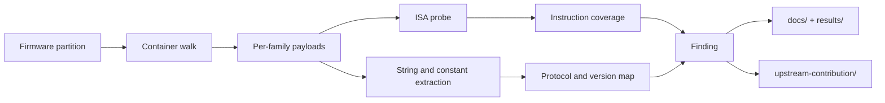

<div align="center">

# Open Device

**Firmware blob research across every device class.**

This project began as the FSF LibrePhone blob research effort and retains that
work as its provenance. Its scope is every device class; current coverage
concentrates on Android phones — Qualcomm (SDM845, SM6375, SM8250, QCM6490/FP6)
and MediaTek — with per-file blob data: 33,917 rows across 123 devices. A
further 122 devices of the 245 inventoried have no blob rows: tablets, TV boxes,
single-board computers and developer boards are not yet catalogued per file.

[Stars](https://github.com/adineo-cmd/open-device/stargazers) · [Last commit](https://github.com/adineo-cmd/open-device/commits)

[Quick start](#quick-start) · [How it works](#how-it-works) · [Features](#features)

</div>

---

Work for the FSF's [LibrePhone](https://www.fsf.org/news/librephone-project)
initiative: identify what proprietary firmware actually is, and write it down.
The measured corpus is 33,917 blob rows across 123 devices; the wider inventory
holds 245 device models of which 122 have no per-file rows yet.

**Facts are documented; blobs are never committed.** Every analysis ships derived
metadata only — headers, segment tables, hashes, version strings, protocol
constants — plus the script that produced it.

## Features

| | Feature | What it does |
| --- | --- | --- |
| 🔍 | **ISA identification** | Instruction-level proof of which core runs each firmware family, including the vendor's own mistakes. |
| 📦 | **Format documentation** | Container layouts, segment chains, signing schemes and the tools that walk them. |
| 🧾 | **Boot-chain census** | Every firmware family on the SoC mapped, from bootloader to TrustZone. |
| ⬆️ | **Upstream package** | Paste-ready contributions reconciled against live upstream documentation. |

## How it works

Two vendor fronts, the same method:

1. **Extract** — pull the firmware partition and walk its container format.
2. **Identify** — disassemble entry points and prove the ISA from real
   instruction coverage, not from a header field.
3. **Cross-reference** — compare against upstream drivers and public
   documentation; record what upstream gets wrong.
4. **Publish** — write the finding, the evidence and the reproduction script.



## Quick start

Python 3.10+, `capstone` for disassembly. You supply your own device dump; none is in this repository.

**Qualcomm — Fairphone FP6**

```bash
python3 tools/qualcomm/census.py --help
python3 tools/qualcomm/wpss_disasm.py --help
```

**MediaTek — Redmi Note 10S**

```bash
python3 tools/mediatek/isa_probe.py --help
python3 tools/mediatek/region_scan.py --help
```

## Project structure

```text
research/         evidence-classed findings, grouped by subject
                  fleet/ qualcomm/ mediatek/ soc/ laptop/ papers/ historic/
tools/            analysis scripts by substrate
                  fleet/ qualcomm/ mediatek/
data/             derived CSV/JSON data; the frozen matrix and inventory stay
                  under upstream-contribution/blob-database/
implementations/  clean-room, spec-derived components
docs/devices/     per-device family notes
upstream/         paste-ready upstream PRs and issue filings
site/             the Open Device static-site generator
AGENTS.md         standing rules, including the issue-claim protocol (Rule 2)
SCOPE.md          legal and ethical boundary
```

Work is decomposed into atomic GitHub issues; claim one with a `CLAIM` comment
before touching its files. See Rule 2 in `AGENTS.md`.

## Two findings worth the trip

| Vendor | Finding |
| --- | --- |
| Qualcomm | The WCN6750 WiFi core is **32-bit RISC-V** — upstream Linux had labelled it an 8-bit AVR. |
| Qualcomm | The camera ICP and all video-processor firmware are RISC-V; the Bluetooth cores are ARM Thumb; TrustZone is monolithic AArch64. |
| MediaTek | The tinysys/scp core is **ARM Cortex-M4F running FreeRTOS**, not RISC-V. |
| MediaTek | The camera CCU is **Synopsys ARCv2** (two ARC EM4-FPU cores) — first binary-level identification on a production device. |
| MediaTek | The modem entry is MIPS32 LE with MIPS16e islands, which overturns the nanoMIPS attribution that belongs to later Dimensity silicon. |

Full tables, evidence and the falsification chains live in each track's `docs/`.

## Boundary

No proprietary binary, no decompiled output and no device-private data (MAC,
serial, calibration tables) is committed. Only facts and the scripts that produce
them. See `SCOPE.md`.
